<picture><source media="(max-width: 1080px) and (prefers-color-scheme: light)" srcset="assets/mobile/light/01-hero.png" /><source media="(max-width: 1080px)" srcset="assets/mobile/01-hero.png" /><source media="(prefers-color-scheme: light)" srcset="assets/web/light/01-hero.svg" /></picture>
<a href="#trabajo"><picture><source media="(max-width: 1080px) and (prefers-color-scheme: light)" srcset="assets/mobile/light/02-button-1.png" /><source media="(max-width: 1080px)" srcset="assets/mobile/02-button-1.png" /><source media="(prefers-color-scheme: light)" srcset="assets/web/light/02-button-1.svg" /></picture></a><a href="#contacto"><picture><source media="(max-width: 1080px) and (prefers-color-scheme: light)" srcset="assets/mobile/light/02-button-2.png" /><source media="(max-width: 1080px)" srcset="assets/mobile/02-button-2.png" /><source media="(prefers-color-scheme: light)" srcset="assets/web/light/02-button-2.svg" /></picture></a><a href="https://www.linkedin.com/in/sebastian-fernando-revelo-meneses-15180a426/"><picture><source media="(max-width: 1080px) and (prefers-color-scheme: light)" srcset="assets/mobile/light/02-button-3.png" /><source media="(max-width: 1080px)" srcset="assets/mobile/02-button-3.png" /><source media="(prefers-color-scheme: light)" srcset="assets/web/light/02-button-3.svg" /></picture></a><picture><source media="(max-width: 1080px) and (prefers-color-scheme: light)" srcset="assets/mobile/light/02-button-4.png" /><source media="(max-width: 1080px)" srcset="assets/mobile/02-button-4.png" /><source media="(prefers-color-scheme: light)" srcset="assets/web/light/02-button-4.svg" /></picture>
<picture><source media="(max-width: 1080px) and (prefers-color-scheme: light)" srcset="assets/mobile/light/03-profile.png" /><source media="(max-width: 1080px)" srcset="assets/mobile/03-profile.png" /><source media="(prefers-color-scheme: light)" srcset="assets/web/light/03-profile.svg" /></picture>
<picture><source media="(max-width: 1080px) and (prefers-color-scheme: light)" srcset="assets/mobile/light/04-work.png" /><source media="(max-width: 1080px)" srcset="assets/mobile/04-work.png" /><source media="(prefers-color-scheme: light)" srcset="assets/web/light/04-work.svg" /></picture>
<a href="https://github.com/sebas-archive/alerta-sismica-raft-esp32"><picture><source media="(max-width: 1080px) and (prefers-color-scheme: light)" srcset="assets/mobile/light/05-case-1.png" /><source media="(max-width: 1080px)" srcset="assets/mobile/05-case-1.png" /><source media="(prefers-color-scheme: light)" srcset="assets/web/light/05-case-1.svg" /></picture></a>
<a href="https://github.com/sebas-archive/kardex-bt"><picture><source media="(max-width: 1080px) and (prefers-color-scheme: light)" srcset="assets/mobile/light/05-case-2.png" /><source media="(max-width: 1080px)" srcset="assets/mobile/05-case-2.png" /><source media="(prefers-color-scheme: light)" srcset="assets/web/light/05-case-2.svg" /></picture></a>
<a href="https://github.com/sebas-archive/Multiplatform-app-ListView"><picture><source media="(max-width: 1080px) and (prefers-color-scheme: light)" srcset="assets/mobile/light/05-case-3.png" /><source media="(max-width: 1080px)" srcset="assets/mobile/05-case-3.png" /><source media="(prefers-color-scheme: light)" srcset="assets/web/light/05-case-3.svg" /></picture></a>
<a href="https://github.com/sebas-archive/andina-market"><picture><source media="(max-width: 1080px) and (prefers-color-scheme: light)" srcset="assets/mobile/light/05-case-4.png" /><source media="(max-width: 1080px)" srcset="assets/mobile/05-case-4.png" /><source media="(prefers-color-scheme: light)" srcset="assets/web/light/05-case-4.svg" /></picture></a>
<a href="https://github.com/J0ss077/Joss077UMB-ProyectoBlockChain"><picture><source media="(max-width: 1080px) and (prefers-color-scheme: light)" srcset="assets/mobile/light/05-case-5.png" /><source media="(max-width: 1080px)" srcset="assets/mobile/05-case-5.png" /><source media="(prefers-color-scheme: light)" srcset="assets/web/light/05-case-5.svg" /></picture></a>
<a href="https://github.com/sebas-archive/SereOS"><picture><source media="(max-width: 1080px) and (prefers-color-scheme: light)" srcset="assets/mobile/light/05-case-6.png" /><source media="(max-width: 1080px)" srcset="assets/mobile/05-case-6.png" /><source media="(prefers-color-scheme: light)" srcset="assets/web/light/05-case-6.svg" /></picture></a>
<picture><source media="(max-width: 1080px) and (prefers-color-scheme: light)" srcset="assets/mobile/light/06-technologies.png" /><source media="(max-width: 1080px)" srcset="assets/mobile/06-technologies.png" /><source media="(prefers-color-scheme: light)" srcset="assets/web/light/06-technologies.svg" /></picture>
<picture><source media="(max-width: 1080px) and (prefers-color-scheme: light)" srcset="assets/mobile/light/07-credentials.png" /><source media="(max-width: 1080px)" srcset="assets/mobile/07-credentials.png" /><source media="(prefers-color-scheme: light)" srcset="assets/web/light/07-credentials.svg" /></picture>
<a href="https://aws-bogota.ontidwit.com/badge?id=f165ec7a-4a65-4c78-81dd-2d87317b1d5f"><picture><source media="(max-width: 1080px) and (prefers-color-scheme: light)" srcset="assets/mobile/light/08-credential-1.png" /><source media="(max-width: 1080px)" srcset="assets/mobile/08-credential-1.png" /><source media="(prefers-color-scheme: light)" srcset="assets/web/light/08-credential-1.svg" /></picture></a>
<a href="https://aws-bogota.ontidwit.com/badge?id=2fab120f-d6a8-492e-b9e9-76fb3b0802e6"><picture><source media="(max-width: 1080px) and (prefers-color-scheme: light)" srcset="assets/mobile/light/08-credential-2.png" /><source media="(max-width: 1080px)" srcset="assets/mobile/08-credential-2.png" /><source media="(prefers-color-scheme: light)" srcset="assets/web/light/08-credential-2.svg" /></picture></a>
<a href="https://www.skills.google/public_profiles/95ef17b1-7a84-4332-a6ce-d6240234a3f0/badges/29624075"><picture><source media="(max-width: 1080px) and (prefers-color-scheme: light)" srcset="assets/mobile/light/08-credential-3.png" /><source media="(max-width: 1080px)" srcset="assets/mobile/08-credential-3.png" /><source media="(prefers-color-scheme: light)" srcset="assets/web/light/08-credential-3.svg" /></picture></a>
<a href="https://www.credly.com/badges/e4175a54-81e7-4cfc-a235-54239919b7af"><picture><source media="(max-width: 1080px) and (prefers-color-scheme: light)" srcset="assets/mobile/light/08-credential-4.png" /><source media="(max-width: 1080px)" srcset="assets/mobile/08-credential-4.png" /><source media="(prefers-color-scheme: light)" srcset="assets/web/light/08-credential-4.svg" /></picture></a>
<a href="https://www.credly.com/badges/a688c620-f7f8-4fed-87fe-ab4c0ff2c65d"><picture><source media="(max-width: 1080px) and (prefers-color-scheme: light)" srcset="assets/mobile/light/08-credential-5.png" /><source media="(max-width: 1080px)" srcset="assets/mobile/08-credential-5.png" /><source media="(prefers-color-scheme: light)" srcset="assets/web/light/08-credential-5.svg" /></picture></a>
<a href="https://www.credly.com/badges/4c02d262-df0d-4f7c-9e2d-760a05434318"><picture><source media="(max-width: 1080px) and (prefers-color-scheme: light)" srcset="assets/mobile/light/08-credential-6.png" /><source media="(max-width: 1080px)" srcset="assets/mobile/08-credential-6.png" /><source media="(prefers-color-scheme: light)" srcset="assets/web/light/08-credential-6.svg" /></picture></a>
<a href="https://www.credly.com/badges/7d804e61-9301-4301-9cb4-54770edbee2f"><picture><source media="(max-width: 1080px) and (prefers-color-scheme: light)" srcset="assets/mobile/light/08-credential-7.png" /><source media="(max-width: 1080px)" srcset="assets/mobile/08-credential-7.png" /><source media="(prefers-color-scheme: light)" srcset="assets/web/light/08-credential-7.svg" /></picture></a>
<a href="https://www.credly.com/badges/83aeb46d-f0ff-4f86-a0c3-9bca1755ed2f"><picture><source media="(max-width: 1080px) and (prefers-color-scheme: light)" srcset="assets/mobile/light/08-credential-8.png" /><source media="(max-width: 1080px)" srcset="assets/mobile/08-credential-8.png" /><source media="(prefers-color-scheme: light)" srcset="assets/web/light/08-credential-8.svg" /></picture></a>
<a href="https://www.credly.com/badges/abdb13b0-27fb-4c6b-9de7-d2f0ef7c7681"><picture><source media="(max-width: 1080px) and (prefers-color-scheme: light)" srcset="assets/mobile/light/08-credential-9.png" /><source media="(max-width: 1080px)" srcset="assets/mobile/08-credential-9.png" /><source media="(prefers-color-scheme: light)" srcset="assets/web/light/08-credential-9.svg" /></picture></a>
<a href="https://learn.microsoft.com/es-es/users/sebastianfernandorevelomeneses-3521/?tab=tab-learning-paths#trophies-section"><picture><source media="(max-width: 1080px) and (prefers-color-scheme: light)" srcset="assets/mobile/light/08b-paths.png" /><source media="(max-width: 1080px)" srcset="assets/mobile/08b-paths.png" /><source media="(prefers-color-scheme: light)" srcset="assets/web/light/08b-paths.svg" /></picture></a>
<a href="https://learn.microsoft.com/es-es/training/paths/design-infranstructure-solutions/"><picture><source media="(max-width: 1080px) and (prefers-color-scheme: light)" srcset="assets/mobile/light/08c-path-1a.png" /><source media="(max-width: 1080px)" srcset="assets/mobile/08c-path-1a.png" /><source media="(prefers-color-scheme: light)" srcset="assets/web/light/08c-path-1a.svg" /></picture></a><a href="https://learn.microsoft.com/es-es/training/paths/implement-container-app-hosting-azure/"><picture><source media="(max-width: 1080px) and (prefers-color-scheme: light)" srcset="assets/mobile/light/08c-path-1b.png" /><source media="(max-width: 1080px)" srcset="assets/mobile/08c-path-1b.png" /><source media="(prefers-color-scheme: light)" srcset="assets/web/light/08c-path-1b.svg" /></picture></a>
<a href="https://learn.microsoft.com/es-es/training/paths/describe-azure-management-governance/"><picture><source media="(max-width: 1080px) and (prefers-color-scheme: light)" srcset="assets/mobile/light/08c-path-2a.png" /><source media="(max-width: 1080px)" srcset="assets/mobile/08c-path-2a.png" /><source media="(prefers-color-scheme: light)" srcset="assets/web/light/08c-path-2a.svg" /></picture></a><a href="https://learn.microsoft.com/es-es/training/paths/implement-windows-server-hybrid-cloud-management-monitoring-security/"><picture><source media="(max-width: 1080px) and (prefers-color-scheme: light)" srcset="assets/mobile/light/08c-path-2b.png" /><source media="(max-width: 1080px)" srcset="assets/mobile/08c-path-2b.png" /><source media="(prefers-color-scheme: light)" srcset="assets/web/light/08c-path-2b.svg" /></picture></a>
<a href="https://learn.microsoft.com/es-es/training/paths/server-vm-security/"><picture><source media="(max-width: 1080px) and (prefers-color-scheme: light)" srcset="assets/mobile/light/08c-path-3a.png" /><source media="(max-width: 1080px)" srcset="assets/mobile/08c-path-3a.png" /><source media="(prefers-color-scheme: light)" srcset="assets/web/light/08c-path-3a.svg" /></picture></a><a href="https://learn.microsoft.com/es-es/training/paths/microsoft-azure-fundamentals-describe-cloud-concepts/"><picture><source media="(max-width: 1080px) and (prefers-color-scheme: light)" srcset="assets/mobile/light/08c-path-3b.png" /><source media="(max-width: 1080px)" srcset="assets/mobile/08c-path-3b.png" /><source media="(prefers-color-scheme: light)" srcset="assets/web/light/08c-path-3b.svg" /></picture></a>
<a href="https://learn.microsoft.com/es-es/training/paths/windows-server-file-servers-storage-management/"><picture><source media="(max-width: 1080px) and (prefers-color-scheme: light)" srcset="assets/mobile/light/08c-path-4a.png" /><source media="(max-width: 1080px)" srcset="assets/mobile/08c-path-4a.png" /><source media="(prefers-color-scheme: light)" srcset="assets/web/light/08c-path-4a.svg" /></picture></a><a href="https://learn.microsoft.com/es-es/training/paths/windows-server-network-infrastructure/"><picture><source media="(max-width: 1080px) and (prefers-color-scheme: light)" srcset="assets/mobile/light/08c-path-4b.png" /><source media="(max-width: 1080px)" srcset="assets/mobile/08c-path-4b.png" /><source media="(prefers-color-scheme: light)" srcset="assets/web/light/08c-path-4b.svg" /></picture></a>
<a href="https://learn.microsoft.com/es-es/training/paths/manage-virtualization-containers-hybrid-environment/"><picture><source media="(max-width: 1080px) and (prefers-color-scheme: light)" srcset="assets/mobile/light/08c-path-5a.png" /><source media="(max-width: 1080px)" srcset="assets/mobile/08c-path-5a.png" /><source media="(prefers-color-scheme: light)" srcset="assets/web/light/08c-path-5a.svg" /></picture></a><a href="https://learn.microsoft.com/es-es/training/paths/windows-server-hyper-v-virtualization/"><picture><source media="(max-width: 1080px) and (prefers-color-scheme: light)" srcset="assets/mobile/light/08c-path-5b.png" /><source media="(max-width: 1080px)" srcset="assets/mobile/08c-path-5b.png" /><source media="(prefers-color-scheme: light)" srcset="assets/web/light/08c-path-5b.svg" /></picture></a>
<a href="https://learn.microsoft.com/es-es/training/paths/architect-migration-bcdr/"><picture><source media="(max-width: 1080px) and (prefers-color-scheme: light)" srcset="assets/mobile/light/08c-path-6a.png" /><source media="(max-width: 1080px)" srcset="assets/mobile/08c-path-6a.png" /><source media="(prefers-color-scheme: light)" srcset="assets/web/light/08c-path-6a.svg" /></picture></a><a href="https://learn.microsoft.com/es-es/training/paths/implement-disaster-recovery-windows-server-premises/"><picture><source media="(max-width: 1080px) and (prefers-color-scheme: light)" srcset="assets/mobile/light/08c-path-6b.png" /><source media="(max-width: 1080px)" srcset="assets/mobile/08c-path-6b.png" /><source media="(prefers-color-scheme: light)" srcset="assets/web/light/08c-path-6b.svg" /></picture></a>
<a href="https://learn.microsoft.com/es-es/training/paths/azure-fundamentals-describe-azure-architecture-services/"><picture><source media="(max-width: 1080px) and (prefers-color-scheme: light)" srcset="assets/mobile/light/08c-path-7a.png" /><source media="(max-width: 1080px)" srcset="assets/mobile/08c-path-7a.png" /><source media="(prefers-color-scheme: light)" srcset="assets/web/light/08c-path-7a.svg" /></picture></a><picture><source media="(max-width: 1080px) and (prefers-color-scheme: light)" srcset="assets/mobile/light/08c-path-7b.png" /><source media="(max-width: 1080px)" srcset="assets/mobile/08c-path-7b.png" /><source media="(prefers-color-scheme: light)" srcset="assets/web/light/08c-path-7b.svg" /></picture>
<picture><source media="(max-width: 1080px) and (prefers-color-scheme: light)" srcset="assets/mobile/light/09-contact.png" /><source media="(max-width: 1080px)" srcset="assets/mobile/09-contact.png" /><source media="(prefers-color-scheme: light)" srcset="assets/web/light/09-contact.svg" /></picture>
<a href="mailto:sebastianrevelo.software@gmail.com"><picture><source media="(max-width: 1080px) and (prefers-color-scheme: light)" srcset="assets/mobile/light/10-email.png" /><source media="(max-width: 1080px)" srcset="assets/mobile/10-email.png" /><source media="(prefers-color-scheme: light)" srcset="assets/web/light/10-email.svg" /></picture></a>
<a href="tel:+573152584158"><picture><source media="(max-width: 1080px) and (prefers-color-scheme: light)" srcset="assets/mobile/light/11-phone.png" /><source media="(max-width: 1080px)" srcset="assets/mobile/11-phone.png" /><source media="(prefers-color-scheme: light)" srcset="assets/web/light/11-phone.svg" /></picture></a><a href="https://www.linkedin.com/in/sebastian-fernando-revelo-meneses-15180a426/"><picture><source media="(max-width: 1080px) and (prefers-color-scheme: light)" srcset="assets/mobile/light/12-linkedin.png" /><source media="(max-width: 1080px)" srcset="assets/mobile/12-linkedin.png" /><source media="(prefers-color-scheme: light)" srcset="assets/web/light/12-linkedin.svg" /></picture></a>

